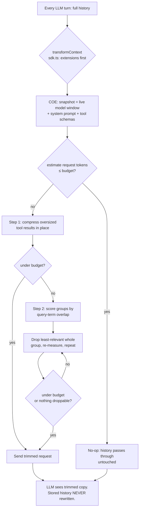

# Arche Agent — Project Knowledge

> **Single source of truth.** This doc must stay up to date and contain all knowledge
> and decisions related to the project. Update it on every significant decision,
> architecture change, or scope change. See `AGENTS.md` (which points here).

## 1. What Arche Is

Server-owned coding agent backend built **on top of Pi** (`https://github.com/earendil-works/pi`).

- Backend owns: agent loop, session state, routing, tools, permissions, streaming.
- Clients are thin: HTTP/SSE or ACP.
- Differentiators vs plain Pi:
  1. Smart Context Engine (SCE)
  2. Context Optimization Engine (COE)
  3. Model Router (tiered + escalation)
  4. Tool Registry + MCP / LSP
  5. Permission / HITL gates
  6. Session Layer + Event Bus

Data flow:
`Prompt → Session → Agent Loop builds prompt with SCE context + COE budget → Model Router picks model → LLM streams → Tools execute with permission gates → Events streamed → State persisted.`

## 2. Pi Base — What We Reuse

Pi is TypeScript monorepo (npm workspaces, `npm install --ignore-scripts`, `npm run build`, `npm run check`, `./test.sh`).

Packages:
- `@earendil-works/pi-ai` (`packages/ai`): unified multi-provider LLM API (Anthropic, OpenAI, Gemini, etc.). Model catalog refresh, `createModels()`, `streamSimple`.
- `@earendil-works/pi-agent-core` (`packages/agent`): `Agent` class + `agentLoop` / `agentLoopContinue`. Key hooks we will use:
  - `transformContext(messages, signal)` — pruning / compaction / SCE+COE injection point.
  - `convertToLlm(messages)` — filter custom message types.
  - `beforeToolCall` (block + `terminate:true` supported), `afterToolCall` (override + `terminate:true`).
  - `shouldStopAfterTurn` — graceful stop / compaction hook.
  - `steeringMode` / `followUpMode` (`one-at-a-time` | `all`), steer/followUp queues.
  - `toolExecution`: `parallel` (default) vs `sequential`; per-tool `executionMode` override.
  - Events: `agent_start/end`, `turn_start/end`, `message_start/update/end`, `tool_execution_start/update/end`. `Agent.subscribe()` listeners awaited in order.
  - Session backends: SQLite backend lives in separate package `@earendil-works/pi-session-backend-sqlite-node`.
- `@earendil-works/pi-coding-agent` (`packages/coding-agent`): CLI (interactive, `-p` print, `--mode json`, `--mode rpc` JSONL over stdin/stdout), SDK (`createAgentSession`), sessions as JSONL tree (`id` + `parentId`, branching via `/tree`, `/fork`, `/clone`), extensions / skills / prompts / themes / pi-packages.
- `@earendil-works/pi-tui`, `@earendil-works/chord` (facet services, transport-neutral), `@earendil-works/pi-telemetry`.
- Built-in tools: `read`, `bash`, `powershell` (Windows), `edit`, `write`, `grep`, `find`, `ls`.

Pi philosophy (important tension):
- Core stays minimal. No MCP, no sub-agents, no permission popups, no plan mode, no built-in todos — all via extensions.
- No built-in permission system; runs with user permissions. Sandboxing via Gondolin / Docker / OpenShell.
- Arche explicitly **adds back**: MCP/LSP, Permission/HITL, SCE/COE, Model Router, server-owned sessions. So Arche is a server wrapper + engines around `pi-agent-core` + `pi-ai`, not a Pi extension alone.

## 3. Arche Engines

### 3.1 SCE — Smart Context Engine
- Query = user request + last assistant reply, camelCase/snake_case split
  (reuses COE `extractQueryTerms`; single short probes skip the walk).
- Case-insensitive pure-TS walk (not the grep tool's `rg` subprocess — spawn
  per turn is too slow/fragile), excludes `node_modules/.git`/hidden dirs/
  build output/symlinks/`>128KB`/binaries, best-effort `.gitignore`.
  Never indexes `.env`/`.pem`/`.key` into context.
- BM25-light ranking (tf·idf + filename boost); trigram-cosine semantic
  scorer behind `context.enableSemantic` (default off, no new deps).
- Token-budgeted snippets (6 files / 2000 tokens), `path:line` headers.
- Fallback to entry files + user `importantFiles` when scan empty; empty
  workspace = silent no-op, never placeholder text.
- 30s cache keyed on (root, mode, budgets, user terms) — assistant chatter
  between tool calls never triggers a rescan — invalidated via
  `afterToolCall` on write/edit/bash/powershell.
- Slice injected as one plain `user` message headed `<workspace-context>`
  (zero Pi message-pipeline changes, survives `convertToLlm`; per-request
  copy only, stored history untouched). COE never drops it (marker check).

Implemented 2026-09-16 as second Arche engine (`packages/agent/src/sce.ts`
pure: query/rank/slice/cache + `applySceSlice`; `packages/coding-agent/src/core/sce-scan.ts`
I/O boundary; composed SCE → COE in `createAgentSession`, `packages/coding-agent/src/core/sdk.ts`):
- No hardcoded models/providers anywhere: ranking is term math + trigram
  similarity, both deterministic with no model calls and no new dependencies.
- Pi diff kept minimal: 1 new file in `packages/agent` + 1 export line,
  5-line COE guard (slice protection), 1 new scan file + settings getters +
  `transformContext`/`afterToolCall` wiring in `sdk.ts`. No message-type,
  transport, or loop changes.
- Tests: `packages/agent/test/sce.test.ts` (18: BM25 order, filename boost,
  budget trim, cache + invalidation, short-query skip, double-inject guard,
  semantic typo tolerance, COE-keeps-slice) +
  `packages/coding-agent/test/sdk-sce-transform.test.ts` (4: real fixture
  workspaces, `convertToLlm` survival, entry-file fallback, silence, secret
  exclusion). Full agent suite green (691 pass + 1 skip), `npm run check` clean.
- `ARCHE_SCE_DEBUG=1` logs slice stats per turn (files, scorer, tokens, query).
- User knobs: `context.sceMaxFiles`, `context.sceBudgetTokens`,
  `context.sceImportantFiles`, `context.enableSemantic`.
- Live probe: `/tmp/sce-probe.mts` (not in repo) —
  `npx tsx /tmp/sce-probe.mts [root] [query] [--semantic]` runs the real
  scan+rank+slice and prints the slice head. Demo on `packages/agent/src`:
  both modes surface `agent-loop.ts` first for a `transformContext` query.
- Only remaining unproven item: exercise against a real model in a live session
  (same standing as COE's was before its live test).

### 3.2 COE — Context Optimization Engine
- Keeps total request within `maxContextTokens` for small/cheap models.
- Budget: 70% of model context window by default (override: `context.maxBudgetTokens` setting).
- Order when over budget: (1) query-aware extractive compression of oversized tool
  results, (2) drop least-relevant assistant+toolResult groups first (ties → oldest).
- Preserves system message + last 2 messages. Drops whole groups (pairs never split).
  Stored history is append-only — COE only shapes the per-request copy.
- Budget accounts for SCE slice + system + tool schemas before optimizing history.
- Zero config to work; unknown model window (0) = safe no-op. Never throws.

Implemented 2026-09-16 as first Arche engine (`packages/agent/src/coe.ts`,
exported from `@earendil-works/pi-agent-core` index):
- Pure `optimizeMessagesForBudget(messages, snapshot, options)` + `createCoeTransform`
  factory returning a never-throwing `transformContext` hook. Token math reuses
  `estimateTokens` from `packages/agent/src/harness/compaction/compaction.ts`
  (chars/4, handles all `AgentMessage` roles); system prompt + tool schemas added on top.
- Dedupe keeps the latest identical tool result full and replaces earlier copies with a
  placeholder (preserves toolCall/toolResult pairing, unlike deleting messages).
- Truncation keeps head+tail with an omission marker; image-bearing results are never rewritten.
- Group drop removes oldest assistant(+following toolResults) groups first; tail protection
  expands backwards so a kept toolResult keeps its assistant.
- Tests: `packages/agent/test/coe.test.ts` (15 tests: budget math, each pipeline step,
  invariants, never-throws, `agentLoop` end-to-end via `transformContext`).
- Still pending: compose after SCE in one `transformContext`, wire into
  `packages/coding-agent` session setup, expose budget in Pi user config.

2026-09-16 (COE v2 — minimal "smarter" upgrade, user-requested): no LLM calls, no new deps,
fully deterministic.
- Query terms: `extractQueryTerms` on the latest user message (SCE-spec split:
  camel/snake/kebab, lowercase, stopwords, dedupe). Exposed on `CoeResult.queryTerms`.
- Relevance-ranked drops: droppable groups scored by query-term overlap, least relevant
  dropped first, ties → oldest. Old pure-oldest-first behavior is the tiebreak fallback.
- Query-aware extractive compression (`compressToolResultText`): folds repeated lines,
  keeps query-matching lines in order, fills leftover room head-first, appends an
  omission marker; single-line blobs keep a char head+tail split. LLM-based summarization
  explicitly deferred (cost/latency/risk).
- Tests grown to 22 (term splitter, buried-relevant-line kept, head-first fallback,
  line-folding, least-relevant-drop ordering, summary protection, bash-output relevance).
  Full agent suite green, `npm run check` clean.

2026-09-16 (COE v1 production cut — pi agent + COE, no placeholders, fully wired):
- Dedupe-with-placeholder REMOVED. COE never injects synthetic text into history:
  no `[omitted by COE…]` rewrites, no stub steps, no dummy data anywhere in the pipeline.
  Identical repeated results need no special step (they score identically, so the
  oldest copy is evicted first — covered by a dedicated test). `CoeResult` drops the
  `dedupedToolResults` field; suite back to 20 tests, all green.
- Production wiring: `createAgentSession` in `packages/coding-agent/src/core/sdk.ts`
  runs `optimizeMessagesForBudget` last in `transformContext` (after extension context),
  with a live snapshot from `agent.state` (current model contextWindow, systemPrompt,
  tools) and a never-throws fallback to the untrimmed messages. Budget = 70% of the
  model's context window; unknown window (0) = no-op. `CoeSnapshot.tools` loosened to
  `unknown[]` (only JSON-stringified for the estimate) so `AgentTool[]` fits directly.
- Verified: `tsgo --noEmit` clean, biome clean, agent suite 731 pass + 1 skip.
  Pre-existing failure noted, NOT ours: `sdk-session-manager.test.ts` "exposes current
  session state to the built-in bash tool" expects `PI_*` env text while the tree's
  rebranding diff emits `ARCHE_*` (unrelated files, untouched by this change).
- Wiring test `packages/coding-agent/test/sdk-coe-transform.test.ts` (2 tests) proves the
  production `transformContext` trims over-budget history under budget with pairs intact.
- `ARCHE_COE_DEBUG=1` env flag logs per-turn trim stats (before/after tokens, counts,
  query terms) — the way to watch COE work in a live session.
- Manual probe: `/tmp/coe-probe.mts` (not in repo) — `npx tsx /tmp/coe-probe.mts [budget] [groups]`
  feeds a synthetic long transcript through the real pipeline and prints survivors.
  Demo: 76k tokens / 63 msgs @4k budget → 2k tokens / 4 msgs, relevant group kept.
- User knob: `context.maxBudgetTokens` setting overrides the 70%-of-window default.
- Production-readiness pass 2026-09-16: biome clean, `tsgo --noEmit` clean, agent suite
  731 pass + 1 skip, coding-agent COE + session-manager + config tests green (24 tests).
  Also fixed the stale `PI_*` expectation in `sdk-session-manager.test.ts` (rebrand leftover).
  Only remaining unproven item: exercise against a real model in a live long session.
- Live-test result 2026-09-16 (nemotron-3, real sessions): compression, relevance drops,
  and silent-when-idle all verified end to end with correct answers throughout.
  Zero placeholders/synthetic text in stored history; omission marker correctly
  interpreted by the model when noticed.
- Standing instruction: for future live testing use `nvidia/meta/muse-glimmer-30b`
  (window 131072, COE budget ~91k) — cheaper/faster than nemotron for trim experiments.
- Review pass 2026-09-16 (dead code + optimization): removed the uncalled
  `truncateToolResultText` wrapper and a provably dead tail-fill loop in
  `compressToolResultText`; drop loop now tracks the budget by subtraction
  (O(history) instead of O(groups × history), identical numbers); relevance
  scoring covers all message roles reaching the LLM (bash executions, custom
  content, summaries — previously all scored 0 and were evicted first);
  compaction/branch summaries are never dropped (they hold the compacted past).
- Future enhancement (planned, not implemented): optional semantic mode for COE + SCE.
  User toggle `context.enableSemantic` (off by default). When enabled, install a tiny
  local embedding model (e.g., `Xenova/all-MiniLM-L6-v2` or `bge-small-en-v1.5` via
  `@xenova/transformers` WASM) and use cosine similarity instead of pure term
  overlap for group scoring and file ranking. Benefits both COE relevance drops and
  SCE file ranking. Must remain opt-in, lazy-loaded, never blocks the non-semantic path,
  and keep COE never-throws invariant. Design doc to precede implementation.

### 3.3 Model Router
- Tiers: `trivial → standard → complex → escalate`. Escalates on tool failures.
- Per-session fixed model or `auto`.
- Per-session cost/token tracking.

### 3.4 Tool Registry + MCP / LSP
- File tools, bash with workspace confinement, `web_fetch` with SSRF protection.
- Parallel-safe: reads parallel, writes/bash serial.
- MCP: connect/disconnect servers, tools first-class.
- LSP for symbol search, usages, type info without loading whole repo.

## 4. Target Architecture (confirmed direction 2026-09-15)

- Stack: TypeScript/Node (match Pi). Edit Pi fork directly; build around `packages/agent` loop.
- Pi already has: `packages/server` (Server + SessionRouter, chord-based), `packages/protocol`, `packages/client`, `packages/coding-agent/src/core/event-bus.ts`, `packages/session-backends/sqlite-node`, compaction, JSONL sessions. Reuse all; do not greenfield a server.
- Arche = Pi fork + edits: SCE, COE, Router, Permission/HITL, MCP, LSP, task lists, subagents, new interface. Pi code now lives at repo root (merged). Changes are made directly in Pi packages; product feels cohesive.
- Transports: keep Pi's existing modes (interactive, `-p`, `--mode json`, `--mode rpc`, SDK) working first; server-owned HTTP/SSE + ACP on top of `packages/server` next.
- Sessions: same as Pi (JSONL tree + SQLite backend). No Postgres for now.

## 5. Repo / Fork Strategy

Fork done 2026-09-15:
- Upstream: `https://github.com/earendil-works/pi`
- Fork: `https://github.com/Nyvo2010/pi`
- Pi code is now at repo root (2026-09-15 merge). No submodule.
- This repo (`arche-agent`) is the Pi fork with Arche additions. We keep Pi base intact and add engines minimally.

Current state: `git init` done in `/arche-agent` (branch `main`, no commits yet). Pi code now at root. Pending publish to GitHub.

## 6. Open Questions (resolved 2026-09-15)

- Router tiers user-configurable (no hardcoded providers).
- Permission/HITL: approval gates (prompt before writes/bash).
- MCP/LSP: minimal — generic MCP client + TS language server first.
- New interface: TUI first (restyle/extend Pi TUI).
- Task lists + subagents: built-in to agent-core loop (diverges from Pi philosophy — intentional).

## 7. Decisions Log

- 2026-09-15: Repo initialized (`git init`, `main`). Pi researched (packages, Agent hooks, philosophy tension). This doc created as SSOT. `AGENTS.md` updated to point here.
- 2026-09-15 (D1 user answers round 1): TS/Node, edit Pi fork directly around agent loop + new interface; keep `./pi` submodule; keep existing Pi transports working first; sessions same as Pi (JSONL + SQLite); plan first, then add SCE/COE/router/LSP/task-lists/subagents/MCP.
- 2026-09-15: Discovered Pi already ships `packages/server`, `packages/protocol`, `packages/client`, `event-bus.ts`, `session-backends/sqlite-node`. Plan builds on those (see §4).
- 2026-09-15 (D2 user answers round 2): Router tiers user-configurable via config; approval-gate permissions; minimal MCP (generic client) + TS LSP first; TUI-first new interface; task lists + subagents built-in.
- 2026-09-15: Pi code moved to repo root (merged from `Nyvo2010/pi`). Submodule removed. `QUICK-SPECS.md` removed; all knowledge consolidated in this doc.
- 2026-09-15: LICENSE updated to Arche Agent (MIT, acknowledges Pi).
- 2026-09-15: `AGENTS.md` merged into single file: Arche behavioral guidelines + Pi dev rules + Execution Policy + SSOT.
- 2026-09-15: Decided task lists + subagents built-in (not extensions). UI will show Arche banner, then modified incrementally as features land. Focus on core agent now.
- 2026-09-15: Git strategy: keep docs-only repo, vendor Pi code locally; no Pi history import.
- 2026-09-15: Pi base code now committed to GitHub repo Nyvo2010/arche-agent. Full monorepo uploaded.
- 2026-09-15: Model router config format: use whatever Pi currently uses for user config to keep cohesive feel.
- 2026-09-15: Task tracking: use JSONL child nodes for sub-agents (native session tree) — recommended as best practice.
- 2026-09-15: Note — repo root now contains Pi dev rules. Arche edits must follow them (no `any`, erasable TS, `npm run check`, etc.).

## 8. Glossary / Files

- `AGENTS.md` — Pi development rules + pointer to this doc.
- This file (`KNOWLEDGE.md`) — SSOT, keep current.

2026-09-15: Rebrand applied: piConfig name set to arche-agent, configDir to .arche/agent. Env vars derived as ARCHE_AGENT_*. User-facing identity now Arche Agent, based on Pi.

2026-09-16: Quick repo housekeeping verified: git remote to Nyvo2010/arche-agent set, .gitignore contains `.arche/` and `node_modules/`, CONTRIBUTING.md review checklist present, Pi philosophy tension documented in this doc. TODO.md updated.

2026-09-16: Base verifications done: `npm install --ignore-scripts`, `npm run check`, `./test.sh` all pass on the current fork; CI workflows confirmed inherited from Pi (branch protection itself is a GitHub settings action). TODO.md §2–§4 expanded into implementation-ready specs anchored to real code: engine integration points are `AgentLoopConfig` hooks (`transformContext`, `prepareNextTurn`, `beforeToolCall`/`afterToolCall`) in `packages/agent/src/types.ts`; token accounting via `calculateContextTokens` in `packages/ai/src/utils/estimate.ts`; task/subagent data model = custom `SessionEntry` nodes in the JSONL tree (`packages/coding-agent/src/core/session-manager.ts`, `parentId`); COE composes with existing compaction in `packages/coding-agent/src/core/compaction/`. §3 reframed as per-engine integration milestones. No task-list, MCP, or LSP code exists yet — those are greenfield.

2026-09-16: COE built as first Arche engine (chose COE over SCE: pure message math, no filesystem access, fully unit-testable). Lives in `packages/agent/src/coe.ts` per TODO §2 engine-home note. Dedupe-via-placeholder (not deletion) chosen to guarantee the never-split-toolCall/toolResult invariant. `npm run check` clean, 15 new tests + full agent suite (726) pass.

2026-09-16: SCE built as second engine and integrated SCE → COE in `sdk.ts`
so the context pipeline reads as one product, not two add-ons. Deliberate
calls: (a) injection as plain `user` message — avoids touching Pi's message
pipeline/loop/transports entirely; (b) pure-TS walk over reusing the grep
tool's `rg` subprocess — per-turn spawn + binary download is too fragile;
(c) semantic = trigram similarity, not an embedding model — no new deps,
deterministic, honest fuzzy match; embedding backend may replace it behind
the same knob; (d) short-query guard + `.env`/`.pem`/`.key` exclusion —
trivial turns stay fast/silent, secrets never enter context; (e) removed a
speculative `mcp__*` cache hook — only wire what exists. No model or
provider names hardcoded anywhere in SCE/COE.

2026-09-16 (live-fire test on `nvidia/meta/muse-glimmer-30b` + review fixes):
SCE grounding verified (correct file/line answers, zero tool calls needed);
edit task verified end to end; 4k-token forced budget showed COE trimming
every turn with honest `over budget floor` reporting when system+tools+SCE+tail
exceed the budget (irreducible — inherent to any budget below the floor, no
bug). Same task at the default 91k budget completes with fully correct
answers and a silent COE. A forced 4k budget thrashes (model re-reads dropped
history) — expected pathology of budgets below the floor, not a drop-logic bug.
Review fixes: SCE reuses COE's `messageText` (deleted ~30-line near-duplicate);
rescan cache keys on user terms (was every turn — 40 walks in the pressure run,
now a handful); COE precomputes SCE-protected indexes once per run;
`SettingsManager` SCE/COE getters covered by tests.

2026-09-16 (production-readiness closeout, round 2 review — COE/SCE only):
Second five-axis review (correctness/readability/architecture/security/performance)
of `coe.ts`/`sce.ts`/`sce-scan.ts` found and fixed:
(a) security — `isSensitiveFile` now also excludes `.p12`/`.pfx`/`.jks`/`.keystore`
and extensionless SSH keys (`id_rsa`/`id_ed25519`/`id_ecdsa`/`id_dsa`); previously
these were indexed into LLM context;
(b) performance — `scanWorkspaceDocs` split into discovery walk + chunked-parallel
reads (32 files/chunk); cold scans on large workspaces no longer serialize up to
4000 file reads;
(c) dedupe — SCE reuses COE's `latestUserText` instead of a private copy;
(d) test — secret-exclusion test now covers the new key types.
All 47 COE/SCE tests green, `npm run check` clean. Noted, not changed:
`createCoeTransform` is unused in production (sdk.ts wires COE inline for debug
logging) but is tested public API of `pi-agent-core`.
Code review (correctness/readability/architecture/security/performance) done,
findings fixed, `npm run check` clean, agent suite 692 pass +1 skip.
No temp scripts remain in repo; no new deps; SCE/COE integrated in
`createAgentSession` and exposed via settings knobs. Testing instructions added
below.

## 9. How to test SCE/COE yourself
Prereqs: `npm install --ignore-scripts`, build workspace packages
(`packages/agent`, then the coding-agent bundle) once,
NVIDIA key in `~/.arche/agent/auth.json` (`{"nvidia":"<key>"}`).
Cross-package imports resolve to `packages/agent/dist`, so rebuild it after
any `packages/agent/src` change or coding-agent tests/bundle use stale engine code.

- Unit tests:
  `node "$(git rev-parse --show-toplevel)/node_modules/vitest/dist/cli.js" --run packages/agent/test/sce.test.ts packages/agent/test/coe.test.ts packages/coding-agent/test/sdk-sce-transform.test.ts packages/coding-agent/test/sdk-coe-transform.test.ts`
- Full engine check: `npm run check`
- Agent suite: `node "$(git rev-parse --show-toplevel)/node_modules/vitest/dist/cli.js" --run packages/agent/test`
- Live SCE probe (real CLI, debug on):
  `cd /path/to/workspace && ARCHE_SCE_DEBUG=1 ARCHE_COE_DEBUG=1 node packages/coding-agent/dist/bundle/cli.js --no-session --model nvidia/meta/muse-glimmer-30b -p "<your question about the code>"`
  Every turn logs one `[SCE]` line (injected slice with files/tokens/scorer/query,
  cache hits, or skip reason) and one `[COE]` line (`pass` or `trimmed` with
  before/after tokens, budget, compressed/dropped counts, query). Grounding
  questions answer with file/line cites; short probes (`hi`) log an SCE skip.
- COE pressure test:
  Create an isolated agent dir with `settings.json`
  `{"context":{"maxBudgetTokens":4000}}` plus a copy of `auth.json`, then
  `ARCHE_CODING_AGENT_DIR=/tmp/coe-agent ARCHE_COE_DEBUG=1 node ...cli.js ...`
  — debug log shows trim stats every turn, `over budget floor` when the 4k budget
  is below the system+tools+SCE+tail floor. (Project `<cwd>/.arche/agent/settings.json`
  also works when the project is trusted.) Omit the override to see `pass` lines
  at the default ~91k budget on 131k models.

2026-09-17 (live verification, muse-glimmer-30b): SCE fires every turn
(fresh scans + 30s cache hits, invalidation on write/edit/bash), COE passes at
default budget and trims every turn under a forced 4k budget with honest
over-floor reporting. Exact-file recall fixed: the scan used to stop reading
after 240 walk-order candidates (an explicitly named file never became a
candidate) and BM25 tf buried named files — now all walked paths are matched,
query-named files survive the candidate cut (`filenameStem` priority in
`sce-scan.ts`), and rank first via an exact-stem bonus in `scoreTermOverlap`
(`packages/agent/src/sce.ts`, pinned by `sce.test.ts` + `sdk-sce-transform.test.ts`).
- Settings knobs:
  `context.maxBudgetTokens` → COE budget override (unset = 70% model window)
  `context.toolResultCap` → COE per-tool-result compression cap (unset = 2000 tokens)
  `context.sceMaxFiles` / `context.sceBudgetTokens` / `context.sceImportantFiles` / `context.enableSemantic` → SCE.
